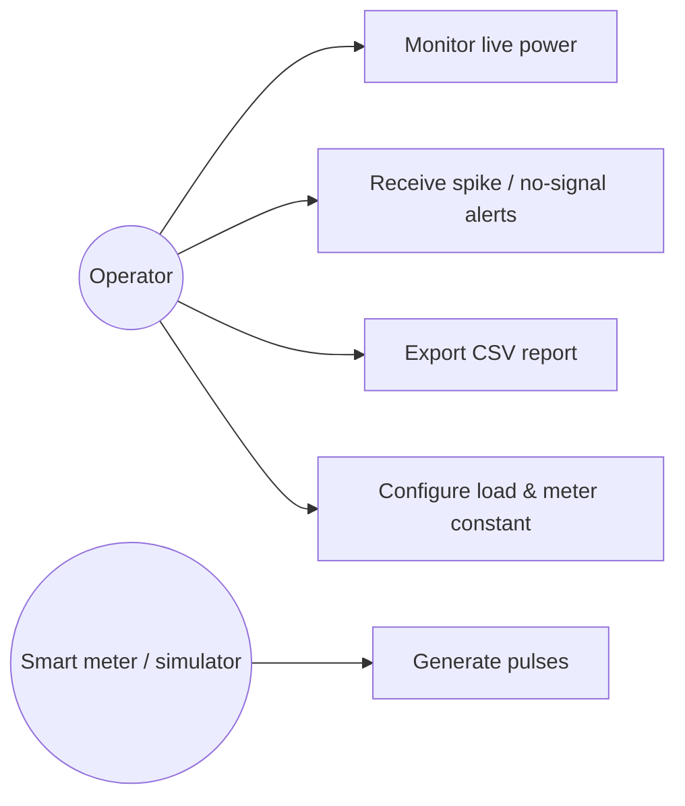
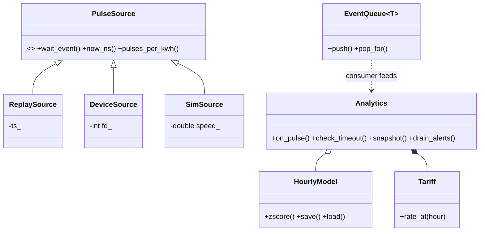
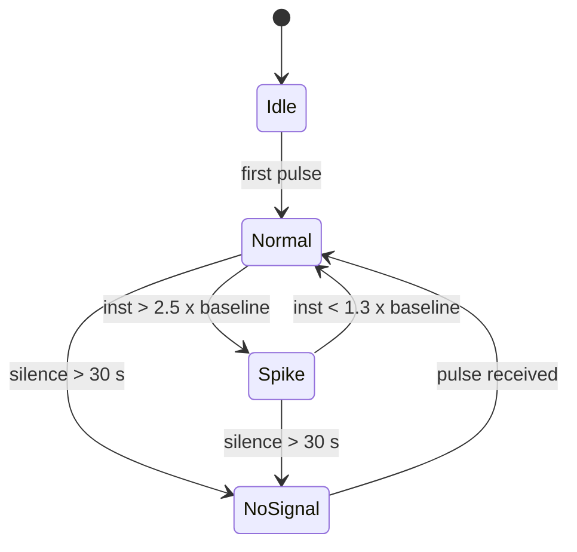
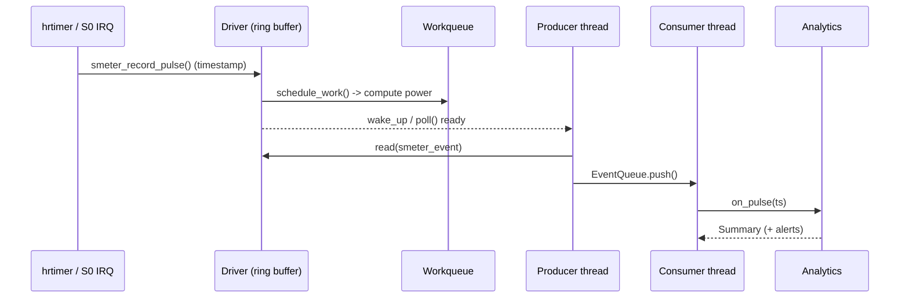

# Design & UML

## Requirements
| ID | Requirement |
|----|-------------|
| R1 | Count meter pulses in the kernel with ns timestamps and no loss under normal load |
| R2 | Expose pulses and control to user space through a character device |
| R3 | Compute instantaneous/average/peak power, energy (kWh) and time-of-use cost |
| R4 | Detect load spikes and loss of signal and raise alerts |
| R5 | Log results to CSV, run in foreground or as a daemon, stop cleanly on SIGINT/SIGTERM |
| R6 | C/C++ only, Ubuntu only, documented on GitHub |

## Use-case diagram

## Class diagram (user space)

## State machine (Analytics)

## Sequence diagram (one pulse)

## Locking rules in the driver
- `sm.lock` (spinlock, `irqsave`): ring buffer and counters; taken from timer (hard IRQ) and process context.
- `sm.cfg_lock` (mutex): serialises ioctl configuration; never taken in atomic context.
- Power maths is deferred to a workqueue so the "interrupt" path stays short.
